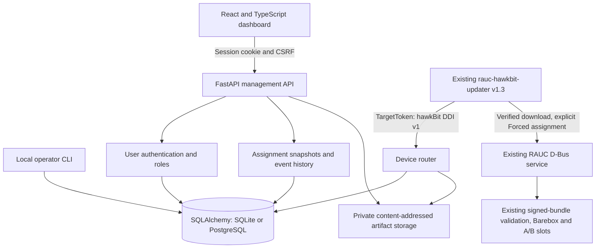

# Architecture · v0.2

The host runs this server; the existing PHYTEC updater, RAUC D-Bus service,
Barebox slot selection and A/B partitions remain on the target unchanged.

## Server boundaries

`app/core` validates configuration, hashes device secrets and implements bounded
JSON requests, correlation and structured logs. `app/database` defines persisted
entities; explicit Alembic revisions manage schema evolution. `app/ddi` contains
controller/config/deployment/download/feedback handlers. `app/management` contains
separate user authentication, schemas and resource endpoints. `app/services`
contains provisioning, storage publication and deployment transition processing.

The application factory checks DB revision and storage before starting. It never
seeds credentials or firmware assignments. The dashboard and API use the same origin;
Vite builds static assets served by FastAPI. Browser polling (5s; timeline 3s) is
independent from device polling. No broker, MQTT or device WebSocket is required.

## Upload and assignment

Multipart parsing occurs only after management authentication. Starlette spools
large file parts to temporary disk; a capped request stream bounds actual incoming
bytes including chunked requests. Metadata and file counts are bounded. The local
storage implementation copies in 1 MiB chunks while computing SHA-256, SHA-1 and
MD5; it fsyncs and atomically links a content-addressed immutable object. No client
filename becomes a storage path. Duplicate content is detected; publication never
overwrites another object. A protocol interface permits a later S3 implementation.

Upload is separate from module creation, release creation and assignment. A module
references one artifact; a distribution references one module. That cardinality
matches v1.3's one-chunk/one-artifact limitation. Assignment copies contents and
hashes into an immutable action snapshot. Release descriptions may change without
altering active downloads. Withdrawal never physically removes bundle data.

Assignment requires an enabled target, available file, exact version/compatible
confirmation, an approval note and an idempotency key. Network retries retain the
action ID. A deliberate reattempt uses a new action linked to the failed one, so
stale feedback cannot corrupt the new attempt. No reinstallation occurs implicitly.

## Concurrency and evidence

PostgreSQL locks the target before assignment/discovery/feedback. A partial unique
index is the final guard against competing active assignments. SQLite uses immediate
transactions for short write requests; uploads avoid holding a write lock while
receiving gigabytes. Device requests commit before returning 200. Artifact streaming
begins after its authorization transaction closes. Revocation affects subsequent
requests; it cannot retract bytes already authorized and in flight.

The first poll exposing a deployment link marks it discovered, closing the safe
server-side cancellation window. Metadata/download and feedback preserve action
identity. Byte ranges and HEAD operate on the same snapshot and private object.
Serving bytes is not proof of checksum or installation: logs distinguish the
server stream from client feedback. A recognized checksum-OK report ends Download
Only; Forced continues to RAUC installation and terminal feedback.

Feedback events preserve raw JSON and device/receipt timestamps. Identical feedback
is deduplicated by a persisted fingerprint. Progress and nonterminal stages cannot
regress; late terminal events remain in history without reopening or overwriting
an action. Installation success does not prove reboot, current running version,
mark-good or absence of rollback. Those signals remain unknown.

## Deployment boundaries

The dashboard uses random server-side sessions, Argon2id passwords, CSRF protection
and admin/operator/viewer authorization. Device auth is separate and tenant scoped.
Management roles are instance-wide; per-user tenant grants are future work.
TLS terminates at a private-network reverse proxy using operator-supplied trust.
Generated links use the explicit public origin; untrusted forwarding headers are
ignored. Production configuration requires HTTPS and PostgreSQL. No server code
writes partitions, selects slots or requests a reboot.
