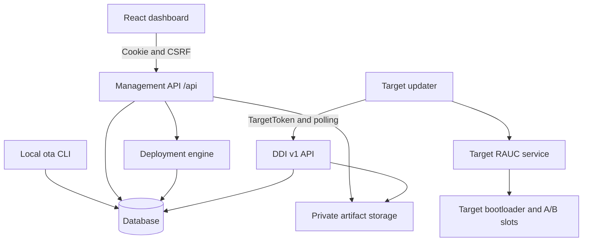
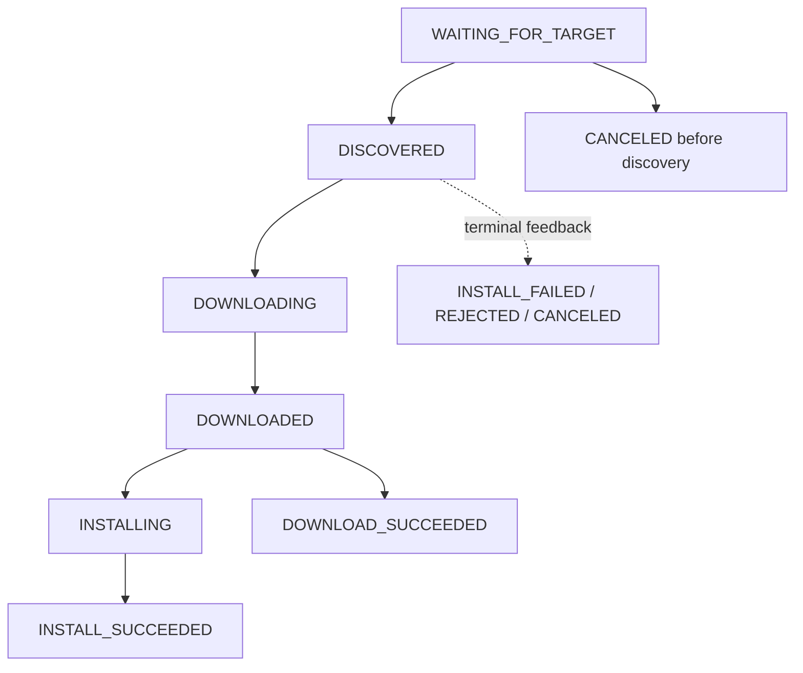
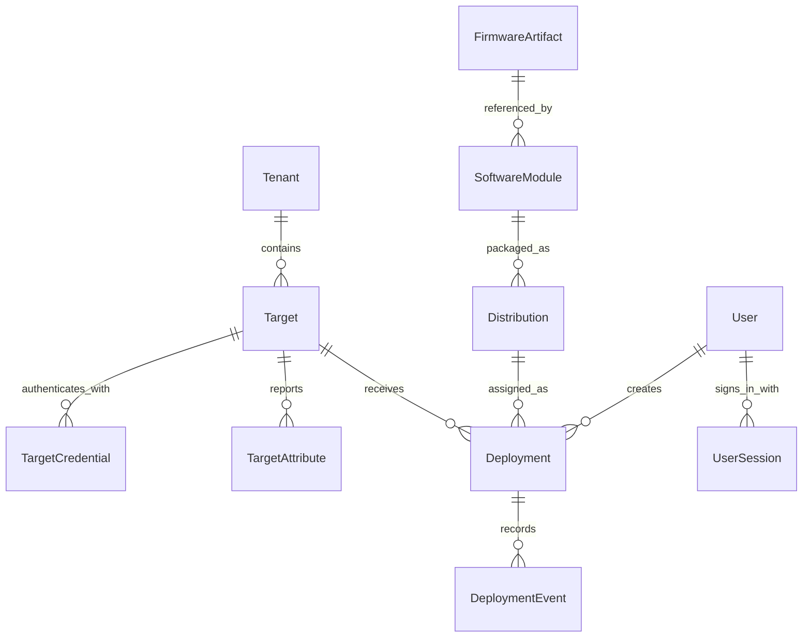

# Complete application code flow

This document follows the current implementation from server startup through the
dashboard, management APIs, database, firmware storage, and target updater. Paths
are relative to the repository root unless linked from this document.

## 1. System overview

The Python server manages firmware and assignments. The existing target updater
polls the server using hawkBit DDI v1, downloads its assigned bundle, and performs
installation through the target's RAUC service. The server does not write target
partitions or select boot slots.



There are two independent authentication paths:

| Caller | Authentication | Scope |
| --- | --- | --- |
| Dashboard | `ota_session` cookie; CSRF header for mutations | Instance-wide user role |
| Target updater | `Authorization: TargetToken <token>` | One target in one tenant |
| Local CLI | Local database access | Operator with access to server configuration |

The database holds application records and hashes of secrets. Firmware bytes live
in the artifact directory. A running RabbitMQ or hawkBit container is not part of
this application's request flow.

## 2. Source map

| File | Main responsibility |
| --- | --- |
| [backend/app/main.py](../backend/app/main.py) | Application factory, startup, routers, health, errors, dashboard assets |
| [backend/app/core/config.py](../backend/app/core/config.py) | Environment and `.env` settings validation |
| [backend/app/core/middleware.py](../backend/app/core/middleware.py) | Request IDs, headers, bounded JSON bodies, request logs |
| [backend/app/core/security.py](../backend/app/core/security.py) | Generate tokens, hash tokens, constant-time verification |
| [backend/app/core/logging.py](../backend/app/core/logging.py) | JSON log formatting |
| [backend/app/database/session.py](../backend/app/database/session.py) | Engine, sessions, migration-head lookup, SQLite pragmas |
| [backend/app/database/models.py](../backend/app/database/models.py) | Database entities and constraints |
| [backend/app/management/auth.py](../backend/app/management/auth.py) | Login, sessions, CSRF, roles, management transactions |
| [backend/app/management/schemas.py](../backend/app/management/schemas.py) | Management input validation |
| [backend/app/management/resources.py](../backend/app/management/resources.py) | Targets, firmware, modules, distributions, deployments, users, summaries |
| [backend/app/services/targets.py](../backend/app/services/targets.py) | Provisioning, credentials, connection status |
| [backend/app/services/artifact_storage.py](../backend/app/services/artifact_storage.py) | Hashing and atomic artifact publication |
| [backend/app/services/deployment_engine.py](../backend/app/services/deployment_engine.py) | Assignment, event creation, state changes, feedback processing |
| [backend/app/ddi/auth.py](../backend/app/ddi/auth.py) | Target authentication and device transactions |
| [backend/app/ddi/controller.py](../backend/app/ddi/controller.py) | Device polling and deployment/config links |
| [backend/app/ddi/config_data.py](../backend/app/ddi/config_data.py) | Reported target attributes |
| [backend/app/ddi/deployment.py](../backend/app/ddi/deployment.py) | Action metadata, artifact streaming, feedback |
| [backend/app/ddi/schemas.py](../backend/app/ddi/schemas.py) | DDI payload validation |
| [backend/app/cli.py](../backend/app/cli.py) | Local administration and target provisioning |
| [frontend/src/main.tsx](../frontend/src/main.tsx) | Mount React application |
| [frontend/src/App.tsx](../frontend/src/App.tsx) | Pages, refresh, dialogs, form submission, timelines |
| [frontend/src/services/api.ts](../frontend/src/services/api.ts) | JSON requests, CSRF, upload progress, request keys |
| [frontend/src/types.ts](../frontend/src/types.ts) | TypeScript API data shapes |
| [frontend/src/components/ui.tsx](../frontend/src/components/ui.tsx) | Shared dialogs, fields, status badges, progress |

## 3. Startup and configuration

Typical local entry point, run from `backend/` after configuring `.env`, building
the dashboard, and applying migrations:

```bash
../.venv/bin/uvicorn app.main:create_app --factory \
  --host 0.0.0.0 --port 8081 --no-proxy-headers --no-access-log
```

Startup sequence:

1. Uvicorn imports `app.main` and calls `create_app()`.
2. `Settings()` reads configuration, including `.env` relative to the working
   directory. It validates the public origin, trusted hosts, polling values, and
   environment requirements.
3. Logging is configured; `build_engine()` creates the SQLAlchemy engine.
4. `schema_head()` reads the expected Alembic revision.
5. The app creates its session factory and `LocalArtifactStorage`, stored in
   `app.state` alongside settings and the engine.
6. It registers middleware, the DDI router, authentication router, and management
   router. Importing DDI config/deployment modules registers their handlers.
7. The lifespan handler creates the artifact directory, verifies database access,
   checks that the database revision matches the code, and probes storage writes.
8. Startup succeeds only after these checks. Shutdown disposes the engine.

Startup does not apply migrations or seed users, targets, or assignments.
Use `alembic upgrade head` and `ota admin-create` explicitly when needed.

| Setting | Code default | Purpose |
| --- | --- | --- |
| `DATABASE_URL` | `sqlite:///./ota.db` | Database connection |
| `ARTIFACT_STORAGE_PATH` | `./storage/artifacts` | Private firmware objects |
| `FRONTEND_PATH` | `../frontend/dist` | Built dashboard files |
| `PUBLIC_BASE_URL` | `http://127.0.0.1:8080` | Origin used in device links; configure for the actual server |
| `POLLING_INTERVAL_SECONDS` | `60` | Default device polling interval |
| `OFFLINE_THRESHOLD_SECONDS` | `180` | Connection-status threshold |
| `MAX_UPLOAD_SIZE_MB` | `2048` | Firmware size limit |
| `MAX_DDI_BODY_BYTES` | `65536` | Middleware limit for ordinary POST/PUT/PATCH bodies |
| `SESSION_HOURS` | `12` | Browser session lifetime |

The configured public hostname must appear in `ALLOWED_HOSTS`; wildcard hosts are
rejected. Production requires an external HTTPS origin and PostgreSQL using the
psycopg driver. Generated device URLs use `PUBLIC_BASE_URL`, not forwarded headers.

`GET /health` is a liveness response. `GET /ready` repeats database, migration,
and writable-storage checks and returns 503 when dependencies are not ready.

## 4. Common request and transaction flow

```text
HTTP request
  -> RequestPolicy: request ID, response headers, applicable body validation
  -> TrustedHostMiddleware
  -> FastAPI route and Pydantic validation
  -> management user dependency OR device dependency
  -> handler -> service -> SQLAlchemy/storage
  -> transaction commit on success; rollback on exception
  -> HTTP response and structured request log
```

`RequestPolicy` adds `X-Request-ID`, `Cache-Control: no-store`, and
`X-Content-Type-Options: nosniff`. Firmware upload uses its own bounded multipart
stream instead of the small JSON limit. The generic JSON body guard applies to
POST, PUT, and PATCH; the permanent-delete DELETE body is validated by its schema.

Management `database()` yields a session and commits after the handler succeeds.
For SQLite, mutating management requests use `BEGIN IMMEDIATE`, except upload, so
the server does not hold a write lock while receiving a large file. Device
authentication also uses an immediate SQLite transaction. PostgreSQL uses row
locks at the target/action operations. Database constraints remain final guards
against duplicates and conflicting active assignments.

Exception handlers in `main.py` translate integrity conflicts to 409, invalid
request payloads to 400, and database errors to a sanitized 503 response.

## 5. Dashboard startup, refresh, and actions

1. `GET /` serves `FRONTEND_PATH/index.html`; `/assets` serves the built assets.
   If the build is missing, `/` returns 503 with build instructions.
2. `main.tsx` mounts `App`.
3. The initial effect calls `GET /api/auth/me` to restore a browser login and CSRF
   token. Without a valid session, the login screen remains available.
4. Once signed in, `refresh()` loads targets, firmware, modules, distributions,
   deployments, summary, and settings concurrently. Admins also load users and
   audit logs.
5. Refresh repeats every five seconds. An open deployment timeline loads its
   action and events every three seconds.
6. Navigation uses the URL hash; table search filters the fetched data locally.
   The app fetches targets with `include_deleted=true`; `showDeleted` controls
   which rows are displayed.
7. `open()` resets dialog errors and upload progress, and creates a fresh
   assignment request key. `submit()` selects the endpoint using `dialog.kind`.
8. A successful action closes/replaces the dialog and refreshes data. An error
   stays in the dialog. Failed uploads clear the progress display.

`api()` sends same-origin cookies and `X-CSRF-Token` for mutations. It reads
backend `detail` errors and signals session expiration on a 401, except login.
`uploadFirmware()` uses XMLHttpRequest for byte-transfer progress.

## 6. Browser authentication and roles

```text
Login form
  -> POST /api/auth/login
  -> check_origin()
  -> persisted login throttling
  -> Argon2 password verification
  -> create UserSession with hashed random session token
  -> set HttpOnly, SameSite=Strict ota_session cookie
  -> return user and CSRF token
```

Production cookies are Secure. The browser keeps the CSRF token in memory through
`setCsrf()`. Each protected management request resolves the session hash and checks
expiry and enabled-user status. Mutations additionally check origin, when
provided, and compare the CSRF token in constant time.

| Role | Allowed operations |
| --- | --- |
| Viewer | Read operational resources and settings |
| Operator | Viewer permissions plus firmware, modules, distributions, assignment, cancellation, retry |
| Admin | Operator permissions plus target lifecycle, credentials, users, audit logs |

Hiding buttons in React is only a convenience; backend dependencies enforce
permissions. User roles apply across the server, without per-user tenant grants.
Logout deletes the current session. Disabling a user removes their sessions.
The local administrator password-reset command also invalidates that user's sessions.

## 7. Target lifecycle

### Create and connect

```text
Add target dialog -> POST /api/targets -> create_target()
  -> detect existing tenant/controller pair, including deleted targets
  -> provision(): validate identity, resolve/create Tenant, insert Target
  -> rotate(): revoke previous credentials, generate token, store token hash
  -> audit records -> return target and plaintext token once
```

Configure the target updater with the same tenant/controller ID, reachable server
origin, and generated token. Creating a target does not assign firmware.

The unique identity is `(tenant_id, controller_id)`, not the display name.
`describe()` computes status in this order: Deleted, Disabled, Never Connected,
then Online/Offline based on `last_seen_at`. `target_view()` adds tenant details,
latest deployment, and the last successful installation version. Running firmware
and boot confirmation remain unknown unless supported evidence is added later.

`PATCH /api/targets/{id}` edits metadata, enabled state, and optional polling
interval. Rotating a token revokes existing active credentials; revoking leaves
the target unable to authenticate until a replacement is generated and configured.

### Delete, restore, and permanently delete

| Operation | Route | Result |
| --- | --- | --- |
| Delete | `DELETE /api/targets/{id}` | Disable, set `deleted_at`, revoke tokens; retain history |
| Show deleted | `GET /api/targets?include_deleted=true` | Include deleted rows |
| Restore | `POST /api/targets/{id}/restore` | Clear deletion timestamp; leave disabled and old tokens revoked |
| Delete permanently | `DELETE /api/targets/{id}/permanent` | Remove target and associated operational history |

Normal deletion is idempotent and is blocked while a deployment is active.
Deleted targets cannot be managed or authenticated. Restore requires enabling
the target and rotating/provisioning a new token before reconnection.

Permanent deletion is admin-only and requires an already deleted target plus:

```json
{"controller_id_confirmation": "test-target2"}
```

`purge_target()` locks the target, checks the exact controller ID and absence of
active deployments, deletes its deployment events, clears retry links, and deletes
its deployments. It records `target.permanently_deleted`, then removes the target.
Foreign-key cascades remove attributes and credentials. Firmware, software modules,
distributions, tenants, and audit logs are retained. The tenant/controller pair
can then be used for a newly provisioned target. The UI requires typing the ID
before submitting; this action cannot be undone through Restore.

## 8. Firmware upload, duplicate detection, and restoration

```text
Upload dialog -> uploadFirmware(FormData)
  -> POST /api/firmware/upload -> Writer authentication
  -> bounded multipart parsing; validate file and metadata
  -> storage.publish() in worker thread
  -> SHA-256 duplicate lookup
  -> insert FirmwareArtifact -> audit -> HTTP 201
```

The endpoint accepts one `.raucb` file and metadata fields `name`, `version`,
`compatible`, `vendor`, and `description`. It validates a safe filename, required
metadata, multipart limits, and configured maximum size. Empty files are rejected.

`LocalArtifactStorage.publish()`:

1. Creates a temporary `.upload-*` file inside the storage directory.
2. Copies in 1 MiB chunks while computing SHA-256, SHA-1, MD5, and size.
3. Flushes and fsyncs the temporary file.
4. Uses its SHA-256 hex digest as the storage key and filename on disk.
5. Atomically publishes with a hard link without overwriting an existing object.
   If an object already exists, verifies its SHA-256 before reusing it.
6. Fsyncs the directory and removes the temporary file in `finally`.

**Duplicate detection compares file contents using SHA-256, not filenames or
the version/name entered in the form.** The database also makes SHA-256 unique.
Renaming the same file or changing form metadata still returns 409. Publication
and the database insert are separate steps: rejecting duplicate metadata does not
delete the existing object. A database failure after publication can leave an
unreferenced storage object; the request does not garbage-collect it.

| Action | Handler | Effect |
| --- | --- | --- |
| Upload | `upload()` | Create one artifact record for new contents |
| Withdraw | `DELETE /api/firmware/{id}` / `withdraw()` | Set `available=false`; keep stored bytes and history |
| Restore | `POST /api/firmware/{id}/restore` / `restore_firmware()` | Set `available=true`; retain original metadata and checksums |

Withdrawal is blocked if an active deployment uses the artifact. Restore is
idempotent and audits an actual availability change. It does not revalidate the
stored file or deploy it; assignment separately checks file presence. Uploading
the contents of a withdrawn artifact returns guidance to restore it.

The form's 100% progress indicates transfer completion. Hashing, publication, and
database validation must still succeed. Upload does not parse or verify the RAUC
manifest/signature; `signature_status` remains `NOT_VERIFIED`. The target's RAUC
service must verify signature trust and compatibility. Enter a compatible string
that matches the actual bundle rather than changing it to bypass a duplicate.

## 9. Software modules and distributions

```text
FirmwareArtifact <- SoftwareModule <- Distribution <- Deployment
```

`POST /api/software-modules` validates that the referenced artifact is available
and creates one module referencing one bundle. Module type is `os`.
`POST /api/distributions` validates the module and creates a distribution
(called a release in some frontend variables). Name/version pairs are unique
within modules and within distributions. A distribution references one module,
matching the updater's one-chunk/one-artifact payload.

`PATCH /api/distributions/{id}` changes its description. Creating modules or
distributions does not assign them to targets.

## 10. Deployment assignment

The deployment review dialog selects an enabled target and distribution and
requires expected version, expected compatible string, explicit approval, and
an approval note. It submits a random `request_key` with the assignment.

`POST /api/deployments` delegates to `assign()`:

1. Look for an existing request key. Return the existing action when target,
   distribution, and mode match; reject conflicting reuse.
2. Lock the target; require that it exists, is enabled, and is not deleted.
3. Reject another active action for that target.
4. Resolve the distribution and module; lock its artifact.
5. Require an available artifact and a file present in storage.
6. Compare the expected compatible string with artifact metadata and expected
   version with distribution version.
7. Copy distribution/module names and versions, filename, size, hashes,
   compatible string, and storage key into the deployment snapshot.
8. Insert an active `WAITING_FOR_TARGET` deployment, an assigned event, and an
   audit record. Retry actions also store `retry_of` and an incremented attempt count.

The snapshot keeps action delivery stable. One active deployment per target is
also enforced by a partial unique index. An assignment does not push a message
to the device; the target learns about it on its next poll.

## 11. Device authentication, polling, and attributes

All DDI paths share this prefix:

```text
/{tenant}/controller/v1/{controller_id}
```

`authenticated_device()` looks up a non-deleted target by tenant/controller ID,
finds its active credential, and verifies the TargetToken hash in constant time.
Missing, disabled, deleted, revoked, or invalid identities return 401. Failed
authentication is audited. A browser login cannot replace a device token.

`GET` on the prefix calls `poll()`:

1. Update `last_seen_at`, `last_request_at`, and `last_poll_at`.
2. Select the target override or default polling interval and format `HH:MM:SS`.
3. Look up its active deployment under lock.
4. On first discovery, change `WAITING_FOR_TARGET` to `DISCOVERED`, set start time,
   and record the discovery event.
5. Return `_links.deploymentBase` when an action exists and `_links.configData`
   when attributes have been requested.

`PUT .../configData` validates a bounded string dictionary and applies `merge`,
`replace`, or `remove` to `TargetAttribute` rows. It clears `config_requested`,
updates activity timestamps, and records an audit entry. Reported attributes are
device data, not independent proof that a version is running successfully.

## 12. Action metadata and downloads

`GET .../deploymentBase/{action_id}` uses `owned()` to require matching action,
target, and tenant. Inactive actions return 410. The response is constructed from
the action snapshot and contains one chunk and one artifact.

Both modes request forced download. `forced` uses `update=forced`;
`download_only` uses `update=skip`. HTTPS links use `download`; HTTP links use
`download-http`.

`GET` or `HEAD .../softwaremodules/{module_id}/artifacts/{filename}`:

1. Require an active assignment for this target, tenant, module, and exact filename.
2. Resolve the private file using the snapshot storage key; check presence and size.
3. Set SHA-256 ETag, byte-range support, content length, and attachment filename.
4. Parse a single range, returning 206 for a valid partial request or 416 for an
   unsupported/unsatisfiable range. An `If-Range` mismatch sends the full file.
5. HEAD returns headers only. GET advances to `DOWNLOADING`, records a download
   request, and streams the selected bytes in chunks up to 1 MiB.

Authorization completes and the device transaction commits before streaming.
Revoking a token affects subsequent requests; it cannot recall an already
authorized stream. The stream completion log measures bytes read by the server,
not client checksum verification or installation success.

## 13. Feedback and state transitions

`POST .../deploymentBase/{action_id}/feedback` validates that the payload action ID
matches the URL and that the authenticated target owns the action. It calls
`receive_feedback()`.

Processing sequence:

1. Normalize the validated payload and hash sorted JSON as a feedback fingerprint.
2. Ignore an identical event already persisted for that action.
3. Extract percentages between 0 and 100 from detail strings and preserve raw
   payload, detail text, device time, receipt time, and event progress.
4. Update target activity. If the action is already terminal, retain the late
   event without reopening it or replacing its result.
5. For active actions, keep progress monotonic and interpret execution/result
   plus recognized detail messages.



This diagram shows the typical order, not mandatory steps. Recognized feedback
can skip intermediate stages. `advance()` only moves active actions forward
through nonterminal stages.

| Input | Effect on active action |
| --- | --- |
| `execution=download` | Advance to `DOWNLOADING` |
| `execution=downloaded` | Advance to `DOWNLOADED` |
| Detail contains `file checksum ok` | Advance to `DOWNLOADED`; finish `download_only` successfully |
| Detail contains `download complete` | Advance to `DOWNLOADED` |
| Percentage or install/copying/checking-slot text | Advance to `INSTALLING` |
| Other nonterminal feedback | Advance at least to `DISCOVERED` |
| `execution=closed`, `finished=success` | `INSTALL_SUCCEEDED` or `DOWNLOAD_SUCCEEDED`, according to mode |
| `execution=closed`, `finished=failure` | `INSTALL_FAILED` with error details |
| `execution=rejected` or `canceled` | Corresponding terminal state |

Terminal processing clears `active` and sets completion time. Successful closed
feedback requests refreshed config data. Installation success is the target's
reported outcome; boot confirmation remains unknown and is not inferred from it.

## 14. Cancellation and retry

`POST /api/deployments/{id}/cancel` locks the target then the action and refreshes
the action before checking its state. Only an active `WAITING_FOR_TARGET` action
can be canceled safely. The first poll exposing the deployment link closes this
window. A cancel records an event and audit entry and sets `CANCELED`.

`POST /api/deployments/{id}/retry` accepts only inactive `INSTALL_FAILED` or
`REJECTED` actions. It builds a new assignment from the previous target,
distribution, mode, and snapshot confirmations, then calls `assign()` with the
previous action reference. Availability and target checks run again. Retrying
creates a new action ID; old feedback remains associated with the old action.

## 15. Database relationships and record ownership



Deployments additionally reference tenant, module, artifact, and optionally a
previous deployment. `AuditLog` stores resource type/ID as data rather than a
foreign key, so audit entries survive permanent target deletion. `LoginThrottle`
persists failed-attempt counters. See [database-schema.md](database-schema.md) for
the wider schema description and migrations for exact database definitions.

## 16. Endpoint navigation map

All management resource routes below are prefixed with `/api`.

| Area | Routes |
| --- | --- |
| Authentication | `POST /auth/login`, `GET /auth/me`, `POST /auth/logout` |
| Targets | `GET/POST /targets`, `GET/PATCH/DELETE /targets/{id}` |
| Target lifecycle | `POST /targets/{id}/restore`, `DELETE /targets/{id}/permanent` |
| Credentials | `POST /targets/{id}/rotate-token`, `POST /targets/{id}/revoke-token` |
| Target history | `GET /targets/{id}/history` |
| Firmware | `GET /firmware`, `POST /firmware/upload`, `GET/DELETE /firmware/{id}`, `POST /firmware/{id}/restore` |
| Modules | `GET/POST /software-modules` |
| Distributions | `GET/POST /distributions`, `PATCH /distributions/{id}` |
| Deployments | `GET/POST /deployments`, `GET /deployments/{id}`, `GET /deployments/{id}/events` |
| Deployment control | `POST /deployments/{id}/cancel`, `POST /deployments/{id}/retry` |
| Operations | `GET /dashboard/summary`, `GET /settings`, `GET /audit-logs` |
| Users | `GET/POST /users`, `PATCH /users/{id}` |

Outside `/api`: `GET /health`, `GET /ready`, `GET /`, static `/assets`, FastAPI
`/docs` and `/openapi.json`, plus the DDI paths described above.

The dashboard summary derives connection counts from live target records and
deployment counts from stored states. `/settings` exposes selected effective
configuration values, not database credentials or secrets. Audit pagination uses
`limit` and optional `before` ID.

## 17. Local CLI and deployment packaging

`ota` resolves to `app.cli:main`. It loads the same settings and accesses the
database directly, rather than making dashboard API calls.

| Command group | Flow |
| --- | --- |
| `admin-create`, `admin-password-reset` | Prompt for password, hash it, create/reset administrator, audit |
| `target-create` | Call `provision()` and write token to a new private file |
| `target-show`, `target-list` | Describe non-deleted targets |
| `target-enable`, `target-disable` | Change enabled state and audit |
| `token-rotate`, `token-revoke` | Change active credentials and audit |
| `request-config` | Set `config_requested` for next device poll |

`write_secret()` creates a new file with mode `0600`, refuses overwrite, and does
not print the token. CLI errors are sanitized. Restore and permanent deletion
are currently management API/dashboard operations, not CLI commands.

[Dockerfile](../deployment/docker/Dockerfile) builds the frontend with Node 22,
installs the Python backend, copies static assets into the runtime image, and runs
Uvicorn as a non-root user. [docker-compose.yml](../docker-compose.yml) supplies
configuration, persistent storage, port mapping, and readiness checks. Apply
migrations explicitly when deploying. The optional Nginx configuration handles
the reverse-proxy boundary; the application does not require a message broker.

## 18. Troubleshooting by code path

| Symptom | Cause/check | Resolution |
| --- | --- | --- |
| `Identical artifact already exists` | `upload()` found the same SHA-256 | Use the existing artifact; Restore it if withdrawn; build new bundle contents for a new artifact |
| Duplicate target conflict | Existing tenant/controller pair, including deleted rows | Manage/Restore it, or permanently delete the deleted record before recreating |
| Restore button returns plain `Not Found` | Frontend may be newer than the running backend | Check live `/openapi.json`; restart the correct backend after deploying code |
| `Resource not found` | Route exists, but the requested database record is missing | Refresh lists and verify the selected record ID |
| Upload displays 100% then fails | Transfer finished before server validation completed | Read the backend error; check duplicates, metadata, storage, limits |
| Target is Disabled after Restore | Restore deliberately leaves it disabled | Enable via Manage, rotate token, configure updater |
| Device 401 | Wrong tenant/controller/token, revoked credential, disabled/deleted target | Check provisioning and updater configuration |
| Browser 403 | Missing/invalid CSRF, disallowed origin, or insufficient role | Sign in again if needed; verify origin and role |
| Deployment creation 409 | Active assignment, unavailable artifact, confirmation mismatch, conflicting request key | Inspect exact error and current target/release state |
| Cancellation 409 | Action already discovered or terminal | Inspect the action; cancellation is supported only before discovery |
| Download 404 | No matching active assignment for target/module/filename | Check assigned action and its snapshot |
| Download 503 | Assigned file missing or size mismatch | Inspect storage and restore the correct artifact object |
| Startup/readiness fails | Database unavailable, migration mismatch, unwritable storage | Check configuration, apply migrations, verify storage permissions |

For a local backend change, stop and restart the Uvicorn process; the documented
command does not enable automatic reload. For frontend changes, rebuild
`frontend/dist` and refresh the browser. For container deployment, rebuild and
recreate the application container. A new button alone does not prove the live
backend has its route. Do not delete the database to resolve a duplicate.

## 19. Verification and related documentation

Tests live in `backend/app/tests/`:

| Test file | Coverage area |
| --- | --- |
| `test_foundation.py` | Configuration, startup, storage/security foundation |
| `test_ddi.py` | Device authentication, polling, attributes, compatibility |
| `test_management.py` | Sessions/roles, lifecycle, uploads, assignments, downloads, feedback, history, concurrency |
| `test_updater.py` | Integration with a separately supplied updater binary |

Run backend checks from `backend/`:

```bash
../.venv/bin/pytest -q
../.venv/bin/ruff check .
```

Build the dashboard from `frontend/` with Node/npm installed:

```bash
npm ci
npm run build
```

Tests normally use disposable SQLite databases. Setting `OTA_TEST_POSTGRES_URL`
uses isolated PostgreSQL schemas; some concurrency checks require PostgreSQL.
Updater integration tests require their external binary/environment and may skip
when unavailable. The frontend build checks TypeScript and bundles assets; it is
not a browser interaction test.

Further reading: [setup and upgrade](../README.md),
[architecture](architecture.md), [API reference](api-reference.md),
[DDI compatibility](ddi-compatibility.md), [security](security.md),
[deployment](deployment-guide.md), and [hardware testing](hardware-testing.md).
