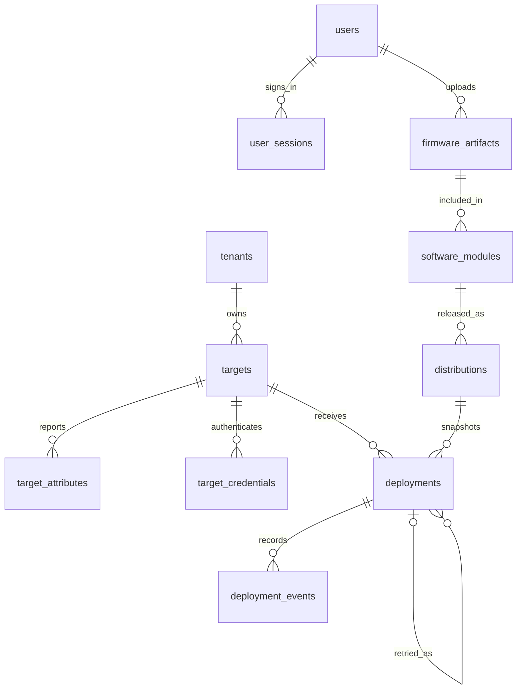

# Database schema · v0.2

Apply migrations explicitly; startup never runs `create_all` or performs automatic
schema changes. Preserve the existing polling database and target credentials.

| Revision | Contents |
|---|---|
| `fbc914596651` | Tenants, targets, attributes, hashed target credentials and audit logs |
| `b61672b156bf` | Users/sessions/throttles, firmware, modules, distributions, actions and events |
| `362b5f20d41c` | Nullable deleted_at on targets; retained history and reversible fleet deletion |

## Current entities

| Table | Important fields and integrity |
|---|---|
| tenants | Unique tenant_code, name, created_at |
| targets | Unique `(tenant_id, controller_id)`, enabled/config_requested, activity timestamps, nullable polling override 1–86399 |
| target_attributes | Unique `(target_id, attribute_key)`; application quotas for string keys/values |
| target_credentials | Unique SHA-256 token digest; partial unique active credential per target; revocation history |
| users | Unique username, Argon2id password hash, role, enabled flag and creation timestamp |
| user_sessions | SHA-256 session-token digest as PK, user FK, CSRF secret and indexed expiry |
| login_throttles | Hashed IP/username bucket key, count and window timestamp |
| firmware_artifacts | Metadata, compatibility, safe display filename, private content key, size, SHA-256/SHA-1/MD5, signature NOT_VERIFIED, uploader FK, availability |
| software_modules | Unique name/version, OS type, metadata and one artifact FK |
| distributions | Unique name/version, description, one module FK and creation timestamp |
| deployments | Tenant/target/release/module/artifact FKs, immutable JSON snapshot, mode, status, active flag, progress, boot UNKNOWN, creator, timestamps, attempt_count and retry_of FK |
| deployment_events | Action FK, event kind, original JSON/details, parsed progress, device timestamp, received timestamp and dedup fingerprint |
| audit_logs | Actor, operation, resource identity, details JSON and indexed server timestamp; no credential material |

`deployments.request_key` is unique. A partial unique index on target_id where
active prevents competing assignments. Each feedback fingerprint is unique within
its action; nullable fingerprints allow distinct non-feedback events. Firmware
size uses BigInteger, supporting bundles beyond signed 32-bit sizes. Artifacts,
modules, releases, users and action history have restrictive foreign keys where
history must remain intact. Withdraw is a tombstone, not physical content deletion.

The first single-bundle RAUC implementation uses direct artifact/module foreign
keys instead of many-to-many content joins. This intentionally disallows unsupported
multi-chunk deployments for v1.3; later client families can add association tables
through a migration without changing existing action snapshots.

All server times are UTC. SQLite returns naive datetime values interpreted as
UTC; the browser explicitly appends a UTC zone before local display. PostgreSQL
uses timezone-aware columns. Raw device times are preserved rather than trusted
as the server clock or used to overwrite terminal evidence.

SQLite enables foreign keys, WAL and a busy timeout; short writes serialize with
immediate transactions. PostgreSQL uses row locks and unique indexes. Migration
roundtrip/drift tests and the API suite can run against both engines. PostgreSQL
tests use explicitly supplied disposable instances with isolated per-test schemas.

Back up before upgrade. `scripts/backup-sqlite.py` creates a consistent private
SQLite backup while including WAL contents. PostgreSQL uses your normal backup
procedure. `alembic downgrade base` destroys data and belongs only in disposable
test databases. Never restore an older schema while a new server is still running.
